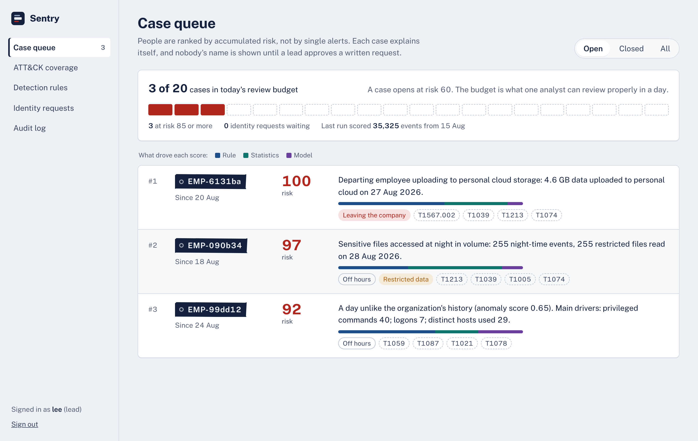
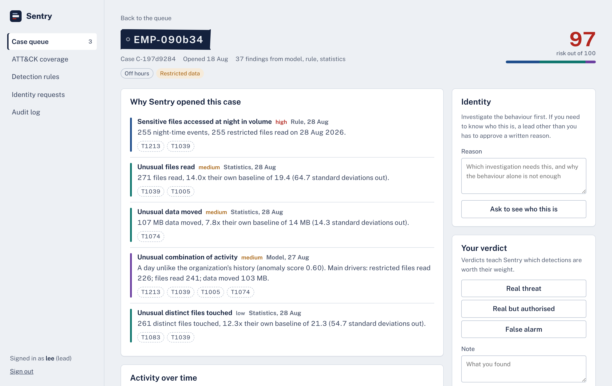
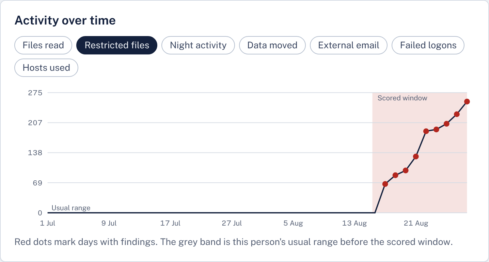
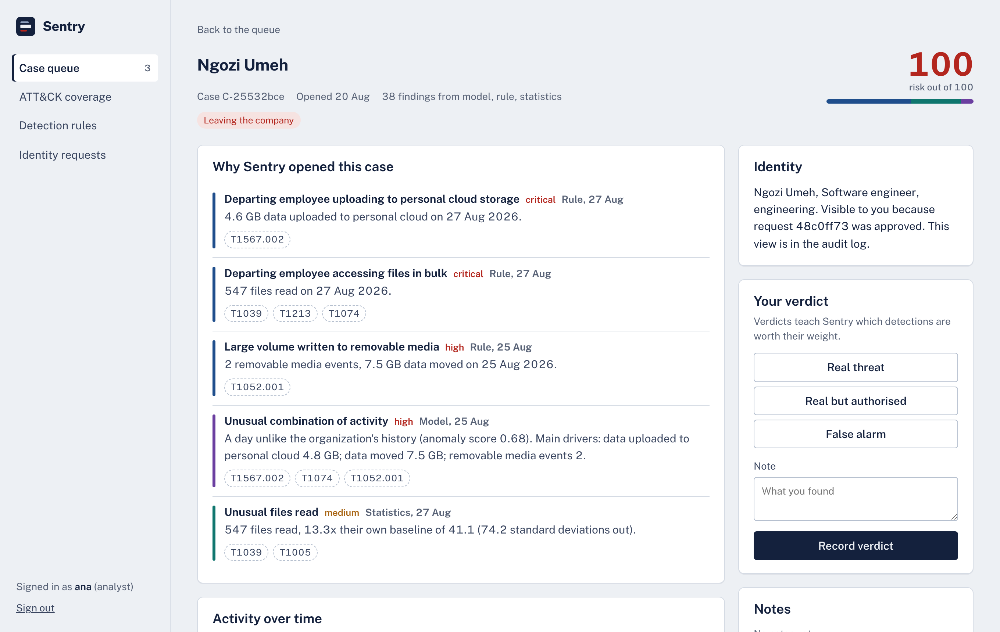
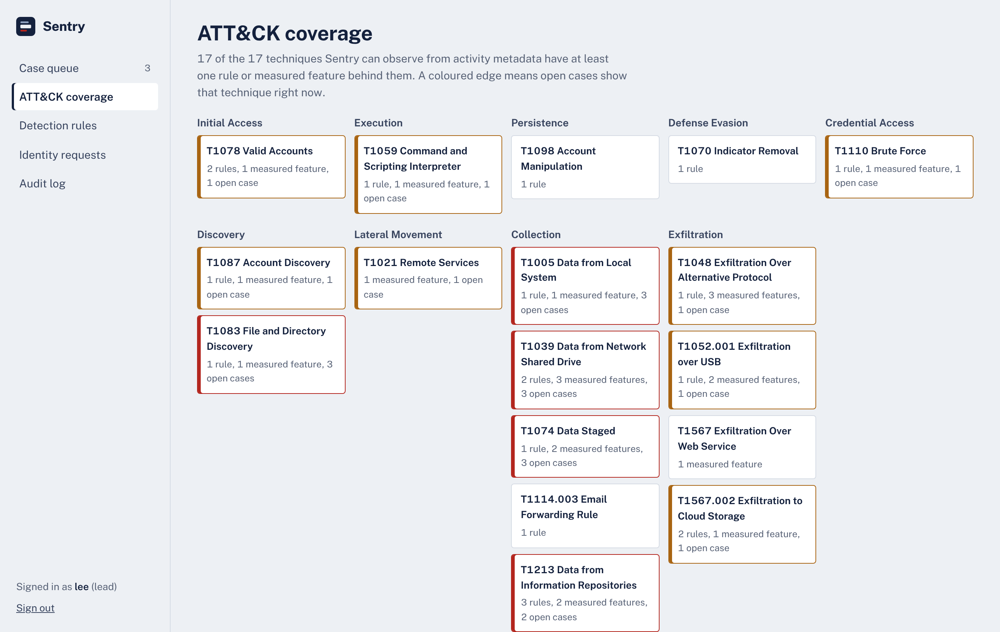

# Sentry

Insider threat detection that accumulates risk per person instead of firing an alert per event, explains every case in plain language, and keeps people pseudonymous until two people agree there is a reason to know who they are.

[](https://github.com/thespaceio/sentry-itds/actions/workflows/ci.yml)
[](https://github.com/thespaceio/sentry-itds/actions/workflows/pages.yml)
[](LICENSE)

**[Try the dashboard demo](https://thespaceio.github.io/sentry-itds/)**: synthetic data, runs in your browser, switch between the analyst and lead roles.

Built by **Faith Alabi** ([SPACEIO](https://github.com/thespaceio)).



Most behavioural monitoring fails the same way. It detects unusual activity accurately, discovers that most unusual activity is innocent, floods the queue, and gets ignored, at which point it is worse than having nothing, because it costs analyst hours and provides false assurance. Sentry is built around avoiding that specific failure.

```
python -m itds generate     # build a labelled synthetic dataset
python -m itds run          # detect, score, rank
```

```
Trained on 104,443 events, scored 35,325 from 2026-08-15
160 detections across 22 entities  |  ML model fitted: True
────────────────────────────────────────────────────────────────────────
Case queue — top 3 of 3

  1. EMP-6131ba   risk 100.0  (departing)
       Risk 100 from 38 findings across ml, rules, statistical.
       • Departing employee uploading to personal cloud storage: 4.6 GB data uploaded to personal cloud on 27 Aug 2026.
       • Departing employee accessing files in bulk: 547 files read on 27 Aug 2026.
       ATT&CK: T1567.002, T1039, T1213, T1074, T1052.001, T1005

  2. EMP-090b34   risk  97.2  (off_hours, restricted_data)
       • Sensitive files accessed at night in volume: 255 night-time events, 255 restricted files read on 28 Aug 2026.
       • Unusual files read: 271 files read, 14.0x their own baseline of 19.4 (64.7 standard deviations out).
```

## Contents

[What it does](#what-it-does) · [Dashboard](#analyst-dashboard) · [Accuracy](#accuracy) · [Install](#install) · [Use](#use) · [Your own logs](#your-own-logs) · [Security and privacy](#security-and-privacy) · [Design decisions](#design-decisions-worth-arguing-with) · [Limitations](#known-limitations) · [Layout](#repository-layout)

## What it does

**Five stages.** Collection, normalization, baselining, three detection engines, risk scoring. The reasoning behind each layer, and what breaks without it, is in [docs/ARCHITECTURE.md](docs/ARCHITECTURE.md).

**Three baselines per person.** Self (is this odd *for them*), peer (is this odd *for their role*), global (is this odd *anywhere*). A new joiner with four days of history is assessed against their department rather than against a baseline that does not exist yet.

**Three detection engines.** 14 YAML rules for precision, z-scores for cheap interpretable coverage, and an Isolation Forest for combinations nobody wrote a rule for. Unsupervised, because labelled insider threat data does not exist.

**Risk, not alerts.** Findings decay with a seven-day half-life, get multiplied by context (departing employee x2, privileged account x1.5, restricted data x1.6, off hours x1.3), and accumulate per person. Cases open when accumulated risk crosses a threshold.

**An alert budget.** The queue is capped at what one analyst can genuinely review in a day. Everything else is tuned so the right cases fit inside it.

**Explanations, enforced.** `Detection.__post_init__` rejects a finding with an empty explanation. Not a convention: a constructor error. The model's findings name the features that drove them, using leave-one-out attribution.

**MITRE ATT&CK on every finding.** All rules and features map to the 17 techniques Sentry can actually observe from activity metadata (`python -m itds attack`). Unknown technique ids fail the rule load.

**Analysts teach it.** Verdicts (real threat, real but authorised, false alarm) produce per-rule precision, flag rules that need tuning, adjust detection weights within x0.5 to x1.5, and can mute a detection for one person for up to 180 days. Re-running the pipeline never overwrites an analyst's decision.

**Real log sources.** Importers for the Windows Security log, Linux auditd, the Microsoft 365 unified audit log, the CERT insider threat dataset and generic CSV or JSONL.

**Alerts that do not leak.** New cases go to a webhook, Slack or email with the pseudonym, score and findings, never a name.

**Privacy controls that actually run.** Metadata-only collection with forbidden fields stripped at ingest, pseudonymous triage, two-person re-identification, a hash-chained audit log of everything analysts do, and enforced retention. See [docs/PRIVACY.md](docs/PRIVACY.md), which includes notes for the Nigeria Data Protection Act 2023, a DPIA outline and an employee notice template.

## Analyst dashboard

A FastAPI service with a dependency-free web dashboard.

| Why a case was opened, with ATT&CK techniques | Each person against their own usual range |
|---|---|
|  |  |
| **After a lead approves a written request** | **Coverage by ATT&CK tactic** |
|  |  |

* **Case queue** inside the daily alert budget, with a bar showing whether rules, statistics or the model drove each score.
* **Case page**: the top findings in plain language, a daily timeline against the person's usual range, every finding by day, ATT&CK techniques, notes and verdicts.
* **Identity requests**: an analyst writes a reason; a lead who is not the requester approves or denies. Only those two people then see the name.
* **Audit log** with a live check that the hash chain is intact.
* **Roles**: analyst, lead and admin, with admins deliberately unable to read cases or approve reveals.
* Light and dark themes, keyboard accessible, works on a phone.

The [demo](https://thespaceio.github.io/sentry-itds/) is the same dashboard running on an exported synthetic snapshot, with every action applied in your browser. Try asking for an identity as the analyst, then approving it as the lead.

## Accuracy

Accuracy in the ordinary sense is deliberately not reported. If 0.1% of users are threats, flagging nobody scores 99.9% and detects nothing. What matters is whether the real threats are near the top of a queue an analyst can actually get through.

### Synthetic benchmark

20 independently generated organisations of 60 people over 60 days (about 139,000 events each), each with three planted threats, two careless but innocent people, two people who resign and behave normally, and a new joiner. Reproduce with `python scripts/benchmark.py --seeds 20`.

| Metric | Result |
|---|---|
| Planted threats ranked #1, #2 and #3 | **20 of 20 datasets** |
| Recall at the alert budget | **1.00** in every dataset |
| Cases opened | 62 across 20 datasets; 60 were planted threats |
| Precision at the alert budget | **0.975** average |
| Clean leavers who opened a case | **0** |
| Careless users (median rank) | 5th, mean risk 40 to 44, below the case threshold of 60 |
| Pipeline time per dataset | about 2.5 seconds |

The two cases that were not threats were a careless USB user who scored 64 and an ordinary employee who scored 63, both just over the threshold. In every dataset the careless users ranked below all three real threats, which is the behaviour the benchmark is designed to test. Catching an obvious exfiltrator is easy; not burying them under the loudest innocent person in the company is the actual problem.

**These are synthetic numbers and should be read as such.** The generator and the detectors were built by the same person, so this shows that the ranking logic works on data designed to stress it, not that Sentry would perform this way on your network.

### CERT Insider Threat Test Dataset

The standard public benchmark: Carnegie Mellon University's r4.2 release, about 1,000 users over 17 months with around 70 insiders. The [Accuracy (CERT r4.2) workflow](.github/workflows/cert.yml) downloads it at run time, verifies its checksum, replays all 17 months in two-week windows and scores every window's queue against the answer key, with and without HR departure dates. Results are published in the workflow summary. `http.csv` is skipped for size, so web-based signals (leak sites, job sites) are unavailable; expect scenario 1 in particular to suffer. See [docs/DATASET.md](docs/DATASET.md).

## Install

Python 3.11 or later.

```bash
git clone https://github.com/thespaceio/sentry-itds
cd sentry-itds
pip install -r requirements.txt
```

Or `docker compose up` (create accounts with `docker compose run --rm sentry python -m itds user add lead1 --role lead`).

## Use

```bash
python -m itds generate --users 60 --days 60   # labelled synthetic dataset
python -m itds run --limit 10                  # detect, rank, alert on new cases
python -m itds cases                           # the open queue
python -m itds explain EMP-6131ba --evidence   # every finding for one entity
python -m itds attack                          # ATT&CK coverage
python -m itds rules                           # rule precision from analyst verdicts
python -m itds purge                           # apply the retention policy
```

Dashboard:

```bash
python -m itds user add analyst1 --role analyst
python -m itds user add lead1 --role lead
python -m itds serve                           # http://127.0.0.1:8000
```

Re-identifying someone from the command line also requires a reason and a second approver, and is written to the audit log:

```bash
python -m itds reveal EMP-6131ba \
  --requested-by analyst1 \
  --approved-by soc-lead \
  --reason "Case 4417: bulk restricted access during notice period"

python -m itds audit verify                    # check nobody has edited the log
```

Alerts are configured with environment variables (`ITDS_ALERT_WEBHOOK_URL`, `ITDS_ALERT_SLACK_WEBHOOK`, `ITDS_ALERT_SMTP_HOST` and friends); see `itds/alerts.py`. Every threshold lives in `itds/config.py` and can be set with an `ITDS_` environment variable.

## Your own logs

```bash
python -m itds import --format windows security.json --identities hr.csv
python -m itds import --format auditd /var/log/audit/audit.log --identities hr.csv --append
python -m itds import --format m365 purview_export.csv --identities hr.csv \
  --internal-domain corp.example --append
python -m itds run
```

The HR file maps every login name, email address and Linux uid to one person and carries department, privilege and resignation dates. Samples of every format are in [`examples/`](examples/). What each source needs to have logging enabled for is in [docs/DATASET.md](docs/DATASET.md).

## Security and privacy

| Concern | What Sentry does |
|---|---|
| Collecting too much | Message bodies, file contents, keystrokes, screenshots and similar are stripped at ingest |
| Biased triage | Analysts see `EMP-6131ba`, a salted HMAC, not a name |
| Curiosity | Identity needs a written reason and a different lead's approval, visible only to those two |
| Watching the watchers | Every sign in, view, verdict and reveal goes into a SHA-256 hash chain |
| Stolen sessions | HttpOnly SameSite=Strict cookies, only token hashes stored, 8-hour expiry |
| Password guessing | scrypt hashes, lockout after five failures, constant-time response for unknown users |
| Cross-site attacks | JSON-only state changes, strict Content-Security-Policy, no third-party scripts, no `innerHTML` |
| Leaky alerts | Chat and email get the pseudonym only |
| Permanent exceptions | Suppressions expire after at most 180 days |
| Keeping everything | Retention purges raw events after 90 days and closed cases after a year |

Before any real deployment, work through the checklist in [docs/PRIVACY.md](docs/PRIVACY.md): change the pseudonym salt, serve over HTTPS with `ITDS_COOKIE_SECURE=1`, export the audit head somewhere the database administrators cannot reach, and complete a data protection impact assessment.

## Design decisions worth arguing with

**Repetition is not corroboration.** Tripping the same detection fourteen days running is one behaviour seen fourteen times, not fourteen findings. Repeats decay steeply: the second instance is worth a third of the first. Without this, the noisiest benign user in the organisation wins the queue every time.

**Diversity is corroboration.** Flagged by rules *and* statistics *and* the model earns x1.25, because the three engines fail in different ways.

**Training and scoring are separated by time.** Baselines are fitted strictly on data before the scoring window. Skip this and a user's anomalous fortnight gets absorbed into the definition of their normal: the system stops detecting anything while continuing to look completely healthy.

**Statistical confidence is capped at 0.9.** An outlier is evidence, never proof.

**Minimum counts and absolute floors, both.** A user who normally touches two files and today touched twelve gives an enormous z-score against a near-zero baseline; that is arithmetic. A user with a genuinely huge baseline can move gigabytes without shifting their z-score at all; that needs a fixed ceiling.

**Feedback adjusts, it never silences.** Learned weights stay between x0.5 and x1.5, and suppressions are per person and time-limited, so a noisy rule gets quieter without becoming a blind spot.

**The model only claims what it can show.** An Isolation Forest finding is tagged with ATT&CK techniques only for drivers that are genuinely elevated, so one failed logon does not turn an exfiltration case into "brute force".

## Known limitations

- **Synthetic validation so far.** The CERT workflow is the next real test; run it before believing anything about real performance.
- **No web proxy signals on CERT.** `http.csv` is skipped for size.
- **Data classification is path heuristics.** Real deployments should feed labels from a DLP or classification system; see `classify_sensitivity`.
- **Peer groups come from department strings.** Clustering on actual behaviour would group people better than the org chart does.
- **Attribution is leave-one-out perturbation, not true Shapley values.** Close enough to rank drivers, cheap enough to run per case.
- **No streaming.** Batch scoring on a schedule. Real-time detection is a different architecture, not a configuration change.
- **One database, one node.** SQLite suits a team-sized deployment, not a large enterprise.

## Repository layout

```
itds/
  schema.py            normalized event and identity model
  config.py            every tunable, in one place
  privacy.py           pseudonymization, reveal gate, collection policy
  storage.py           SQLite persistence (cases survive re-runs)
  pipeline.py          orchestration
  cli.py               command-line interface
  ingest/              synthetic generator; CSV, JSONL, CERT, Windows, auditd and M365 importers
  normalize/           identity resolution, classification, source mapping
  baseline/            daily features; self, peer and global profiles
  detect/              rules, statistics, Isolation Forest, ATT&CK catalogue
  scoring/             risk accumulation, cases, queue evaluation
  feedback.py          verdicts, suppressions, rule health, learned weights
  audit.py             hash-chained audit log
  auth.py              accounts, sessions and roles
  alerts.py            webhook, Slack and email notifications
  evaluation.py        rolling evaluation against an answer key (CERT)
  api/                 FastAPI service
  dashboard/           analyst dashboard (plain JS and CSS, bundled font)
rules/                 14 YAML detections
scripts/               benchmark, dashboard demo build, CERT evaluation
examples/              sample Windows, auditd, M365 and HR files
docs/                  architecture, privacy, datasets, rule authoring
tests/                 102 tests
```

## Development

```bash
pip install -r requirements-dev.txt
make test        # 102 tests
make lint
make demo
make site        # build the dashboard demo into site/
make benchmark   # 10 synthetic organisations
```

## Documentation

- [Architecture](docs/ARCHITECTURE.md): why each layer exists and what breaks without it
- [Privacy and governance](docs/PRIVACY.md): controls, NDPA 2023, DPIA outline, employee notice
- [Datasets and log sources](docs/DATASET.md): synthetic scenarios, CERT, bringing your own logs
- [Writing rules](docs/DETECTION_RULES.md): YAML reference and guidance

## Licence

MIT. See [LICENSE](LICENSE). The bundled Public Sans font is under the SIL Open Font License (`itds/dashboard/fonts/OFL.txt`). The CERT dataset is CC BY 4.0, Carnegie Mellon University, and is not distributed with this project.
